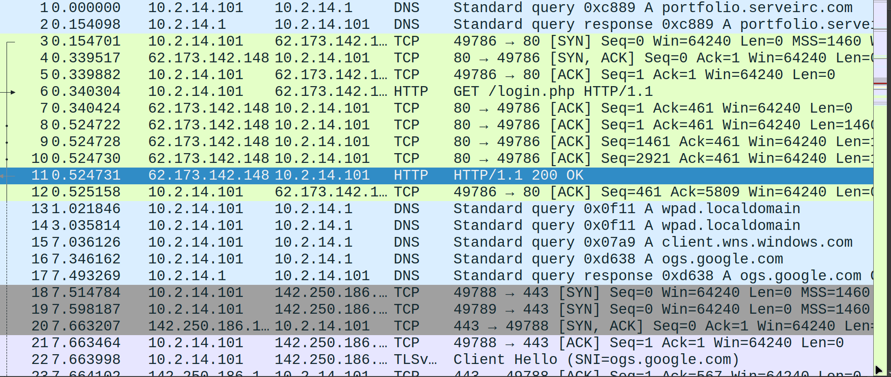
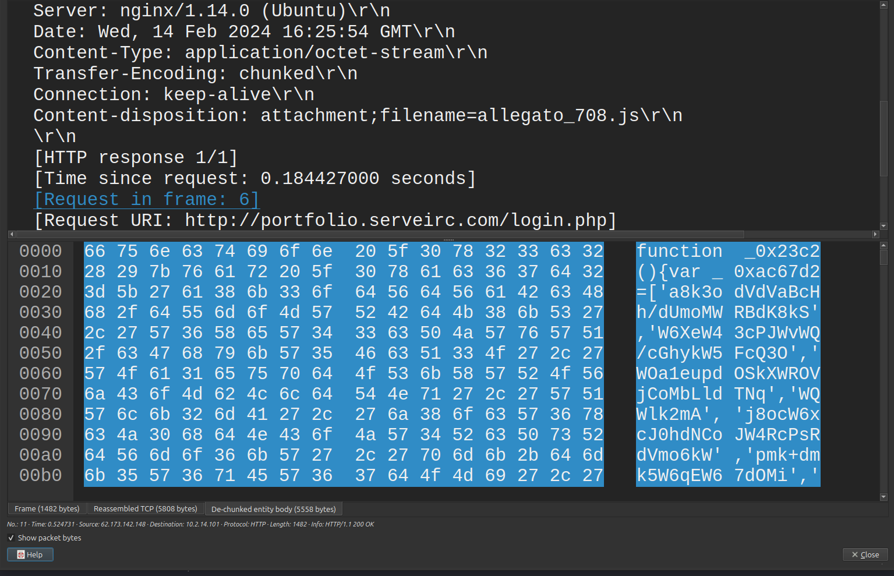
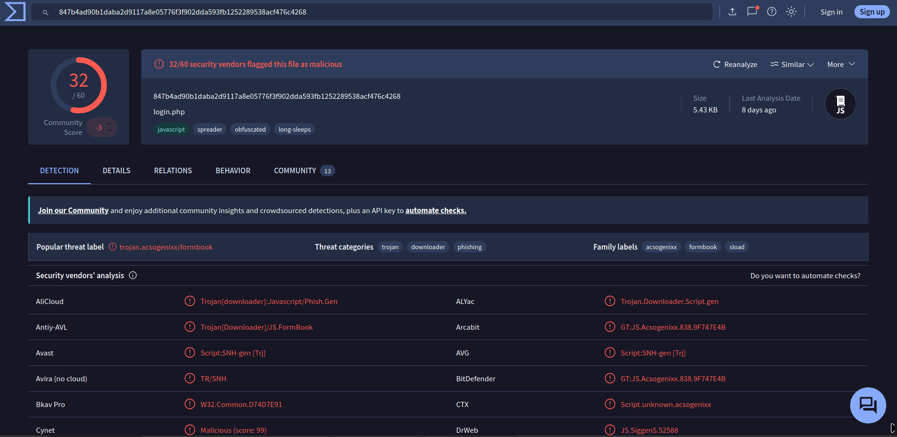
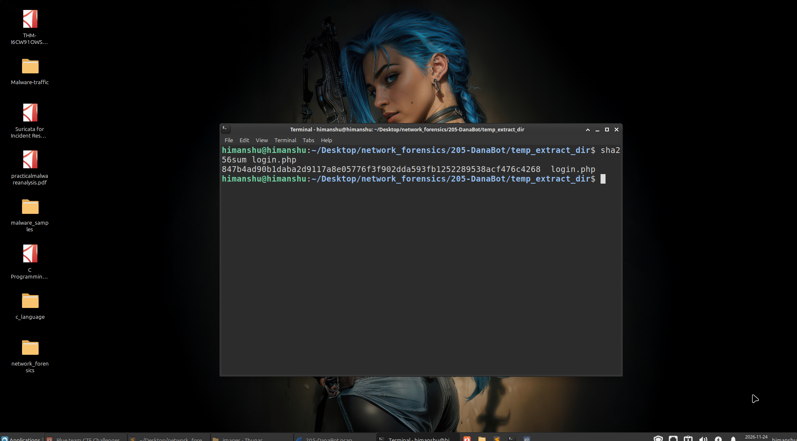

205-DanaBot

# Date: 2026/11/24
## Author: Himanshu
## Title: sensitive company information has been stolen. 
## Tactics: 
- Execution
- Command and Control

## Executive Summary

### Overview
The SOC team has detected suspicious activity in the network traffic, revealing that a machine has been compromised and senstive company information stolen.

### Key Findings
- Which IP address was used by the attacker during the initial access?

I recovered a PCAP file containing network traffic from the compromised host. Initially, all DNS
requests, HTTP, and TCP-based traffic appeared normal to me. However, I noticed something suspicious a host with IP **10.0.2.141** downloaded a file from destination IP **62.173.142.148** a (Nginx Ubuntu) server with extensions **.dll** and **.txt**.

- What is the name of the malicious file used for initial access?

Since it is a DLL file, there may be additional executable files utilizing this DLL for the attack? then I started searching for other files that were used for initial access and surprisingly there were no other relevant files found. Then, I analyzed every request then I was analyzing every request made by the host to the attacker IP 62.173.142.148. The first request was HTTP, and the request method was GET, and URL /login.php looked normal. Then, I analyzed the server response body and there was a file with the name **allegato_708.js** attached.

- What is the SHA-256 hash of the malicious file used for initial access?

Again, I extracted the hash of this file too **847b4ad90b1daba2d9117a8e05776f3f902dda593fb1252289538acf476c4268** and searched it on VirusTotal, and that file was also flagged by 32 security vendors.

- Which process was used to execute the malicious file?

Since the payload is written in JavaScript (as indicated by its extension), it is generally executed by **wscript.exe**.

- What is the file extension of the second malicious file utilized by the attacker?

After reviewing the first file, the second file, **resources.dll**, with the .dll extension looked suspicious because it is often used by attackers to link libraries.

- What is the MD5 hash of the second malicious file?

Then again i performed static analysis by extracting the hashes of resources.dll **e758e07113016aca55d9eda2b0ffeebe** and search them on VirusTotal. Surprisingly, this file was also flagged by 57 security vendors.
