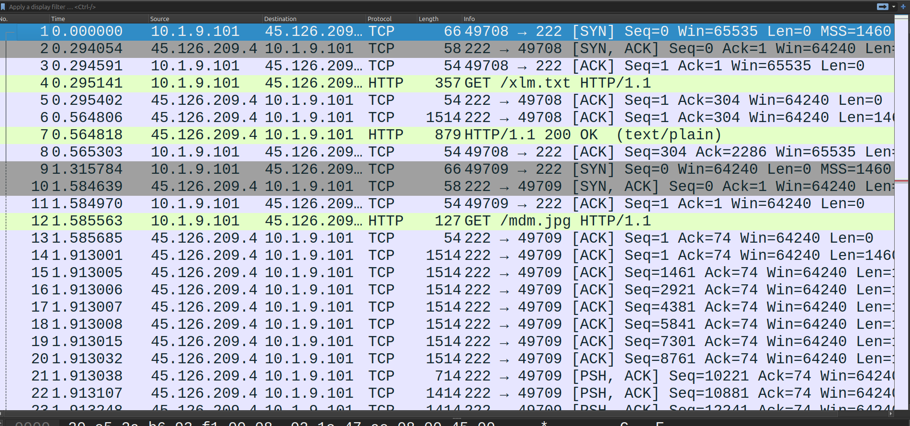
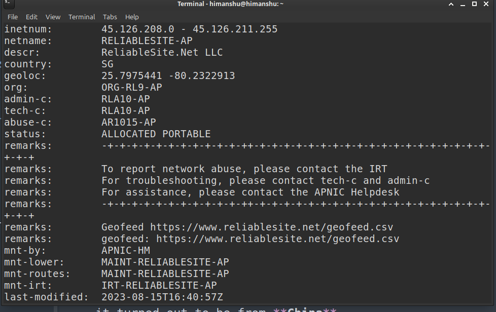
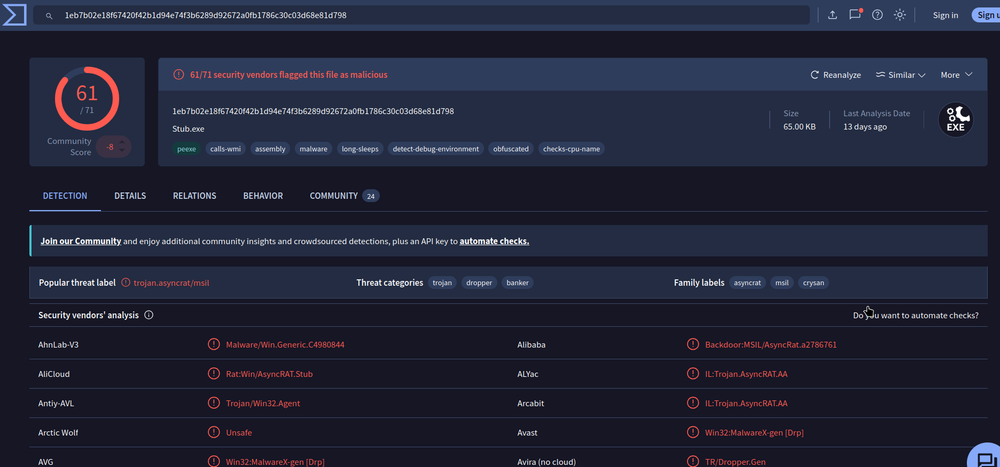
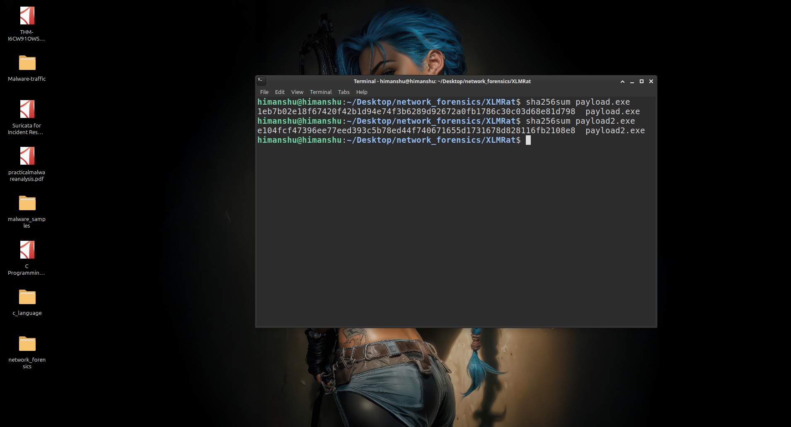

236-XLMRat

#  Date: 2026/11/23
## Author: Himanshu
## Title: Compromised machine has been flagged due to suspicious network traffic. 
## Tactics:
- Execution
- Stealth

## Executive Summary

### Overview
A compromised machine has been flagged due to suspicious network traffic,likely resulting from a dropped malware payload.

### Key Findings
- The attacker successfully executed a command to download the first stage of the malware. What is the URL from which the first malware stage was installed?

PCAP analysis indicates there was no Nmap scan or reconnaissance traffic. all traffic was generated via HTTP possibly indicating that a compromised user downloaded suspicious files or malware, After analyzing the HTTP requests made by the user, it clearly indicates visiting a malicious link and the download of malware or a payload **http://45[.]126[.]209[.]4:222/mdm[.]jpg**

- Which hosting provider owns the associated IP address?

After carefully retrieving and examining the requested URL, it clearly indicates that the threat actor is hosting a web server on a suspicious IP address on port 2222 After searching the IP via WHOIS it turned out that it belongs to **ReliableSite.Net LLC**, a hosting provider from Singapore.

- By analyzing the malicious scripts, two payloads were identified: a loader and a secondary executable. What is the SHA256 of the malware executable?

The compromised user downloaded two files from a suspicious IP 45[.]126[.]209[.]4:222 address via HTTP GET requests for
/xlm.txt and /mdm.jpg. On the surface, these two file appear to be common, harmless files with non-harmful extensions. However, after analyzing both files one resulted in a simple TXT file, while the other contained Unicode text in UTF-8 (with BOM) format possibly encoded text disguised within a JPG file or altered file extensions to reduce suspicion. "The file extension was changed from .jpg to .txt**, revealing an obfuscated script containing two payloads in hex format. Both hex strings were successfully retrieved and extracted , saved as .bin files, and converted into executable files using `xxd`. Finally,SHA-256 hashes of both files were generated and searched on VirusTotal, confirming that one of file was malicious and flagged. 

***`payload.exe 1eb7b02e18f67420f42b1d94e74f3b6289d92672a0fb1786c30c03d68e81d798`***

- What is the malware family label based on Alibaba?

Virustotal report reveal it belong to family `asyncrat, msil, crysan`, Threat categories `trojan, dropper, banker`

- What is the PE header compile (Creation Time) timestamp of the malware?

